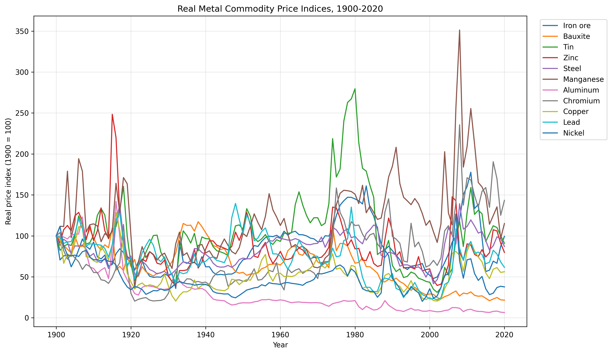
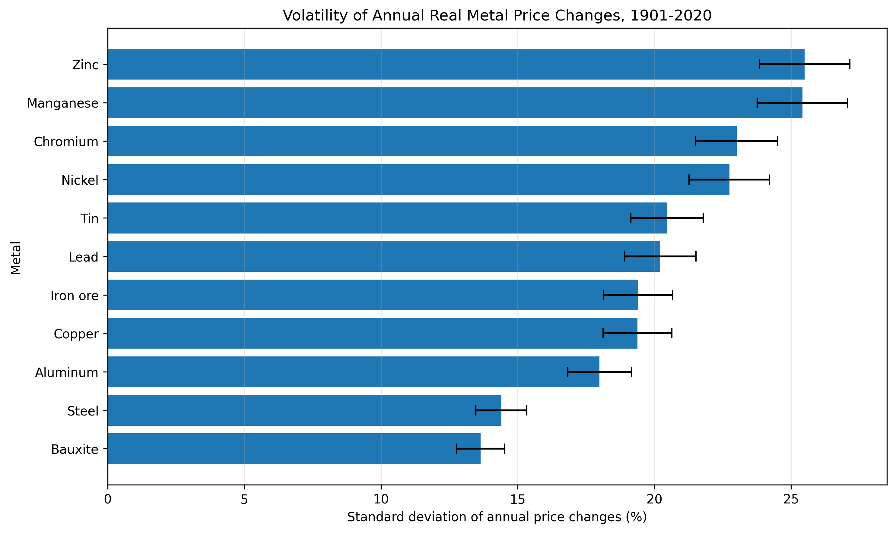
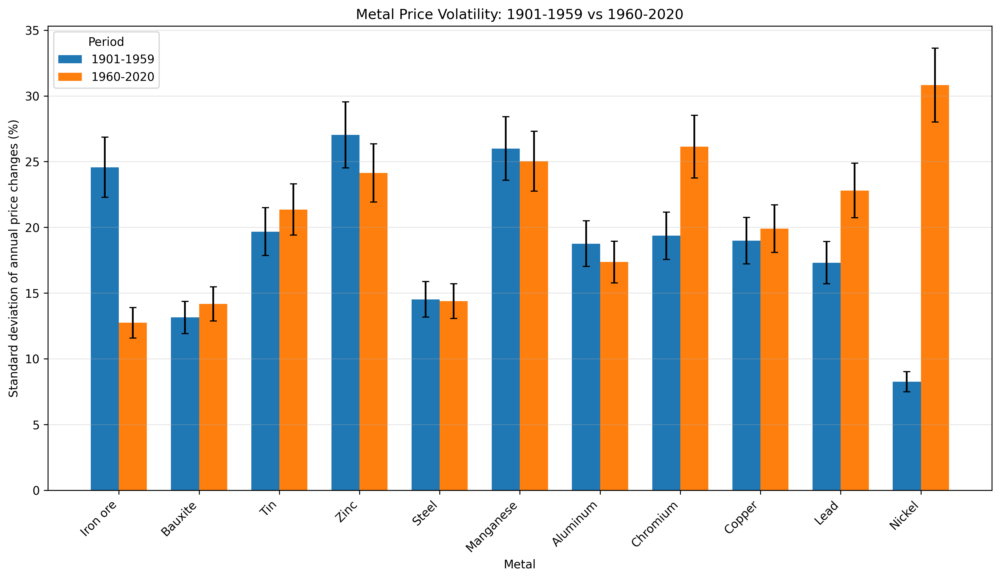
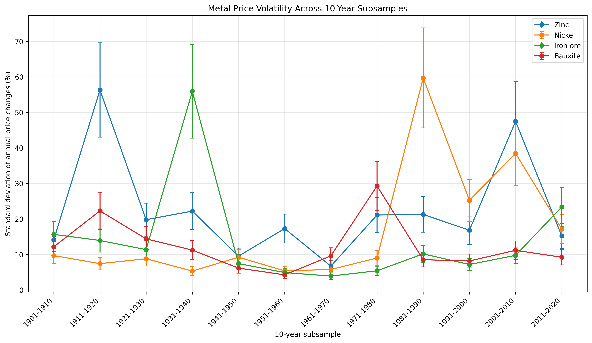
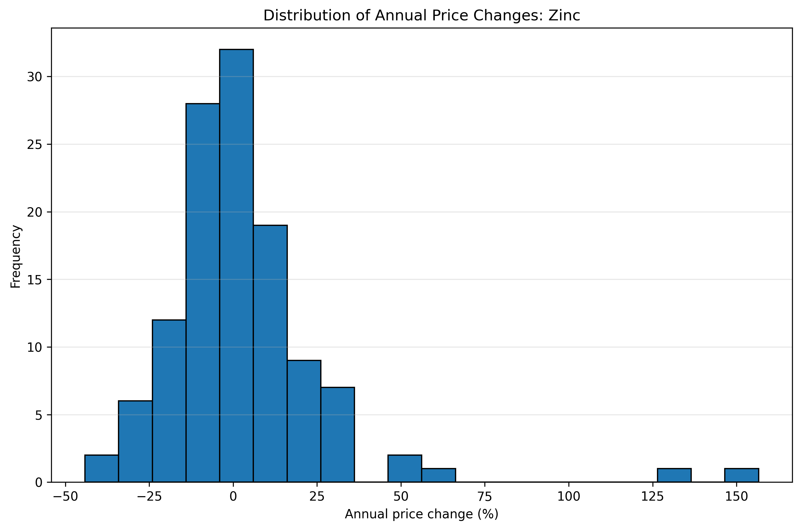

# Statistical Volatility of Real Metal Commodity Prices (1901–2020)

**MAT2007 — Introduction to Programming | Final Project**

## Research question

**Which major metals experienced the greatest real-price volatility between 1901 and 2020, and how has their volatility changed over time?**

This project uses Python to analyze annual changes in inflation-adjusted metal commodity price indices. It compares overall volatility across 11 metals, examines differences between two historical periods, and uses non-overlapping 10-year subsamples to explore changes over time. Statistical uncertainty and the shape of annual price-change distributions are also assessed.

## Dataset

- **Dataset:** [Real commodity price index, metals — Our World in Data](https://ourworldindata.org/grapher/real-commodity-price-index-metals)
- **Underlying historical source:** Jacks (2019), *From Boom to Bust: A Typology of Real Commodity Prices in the Long Run*.
- **Data file:** `real-commodity-price-index-metals.csv`
- **Common index period:** 1900–2020 (121 annual observations per metal)
- **Price-index reference:** 1900 = 100
- **Annual percentage-change period:** 1901–2020 (120 observations per metal)
- **Metals:** iron ore, bauxite, tin, zinc, steel, manganese, aluminum, chromium, copper, lead and nickel.

The analysis uses **real price indices**, rather than nominal prices, to reduce the influence of general inflation. Annual percentage changes are used so that the variability of movements can be compared across metals.

## Repository files

| File | Description |
| --- | --- |
| `metal_price_analysis.py` | Main Python program for validation, analysis, plotting and exporting results. |
| `real-commodity-price-index-metals.csv` | Input dataset downloaded from Our World in Data. |
| `overall_volatility_results.csv` | Full-period statistics for each metal, including volatility, uncertainty, extremes, skewness and excess kurtosis. |
| `period_volatility_results.csv` | Volatility, uncertainty and relative volatility change for the two historical periods. |
| `decadal_volatility_results.csv` | Volatility and uncertainty for each metal in each 10-year subsample. |
| `metal_price_history.png` | Real metal price indices over time. |
| `metal_volatility_with_uncertainty.png` | Overall volatility ranking with approximate standard-error bars. |
| `volatility_period_comparison_with_uncertainty.png` | Comparison of volatility between the two historical periods. |
| `decadal_volatility.png` | Decadal volatility for four selected metals. |
| `most_volatile_histogram.png` | Distribution of annual changes for the metal with the highest overall volatility estimate. |

**Naming note:** The repository should use `metal_price_analysis.py` for the final version of the script. If your final file is currently named `metal_price_analysis(2).py`, rename it when uploading, or update the command below to match its actual filename. The CSV and PNG files are generated by the script and can be regenerated from the input data.

## Requirements and execution

Requires Python 3 and the following packages:

- `numpy`
- `pandas`
- `matplotlib`

Install the dependencies:

```bash
python -m pip install numpy pandas matplotlib
```

Place `metal_price_analysis.py` and `real-commodity-price-index-metals.csv` in the **same folder**. From that folder, run:

```bash
python metal_price_analysis.py
```

The program validates the data, calculates statistics, prints result tables, saves three CSV result files and generates five PNG figures. Figures are also displayed interactively using `plt.show()`; depending on the Python environment, you may need to close each figure window for the script to continue. Output files are saved in the current working directory. The input filename can be changed using the `FILENAME` setting near the beginning of the script.

## Methodology

### 1. Data preparation and validation

The script loads the dataset using `pandas.read_csv()`, selects the common 1900–2020 period, and checks that the required metal columns are available. It checks for duplicate or missing years, sorts the observations chronologically, and rejects missing or non-positive price-index values. These checks help prevent incorrect percentage-change calculations.

### 2. Annual percentage changes

For each metal, the annual percentage change is calculated as:

$$
r_t = \frac{P_t-P_{t-1}}{P_{t-1}}\times 100,
$$

where $P_t$ is the real price index in year $t$. The calculation uses `pct_change(fill_method=None) * 100`. Since the first observation is in 1900, the resulting changes cover **1901–2020**.

### 3. Volatility

Volatility is defined as the **sample standard deviation** of annual percentage changes:

$$
s=\sqrt{\frac{1}{N-1}\sum_{t=1}^{N}(r_t-\bar r)^2},
$$

where $N$ is the number of annual changes and $\bar r$ is their mean. The implementation uses `pandas.Series.std()`, which applies the sample denominator $N-1$. A larger $s$ means that annual percentage changes vary more widely around their mean.

### 4. Statistical uncertainty

The approximate standard error of the sample standard deviation is calculated as:

$$
SE(s)\approx\frac{s}{\sqrt{2(N-1)}}.
$$

Plots display error bars of **±1 approximate standard error**. These are **not 95% confidence intervals**. The approximation assumes independent observations from an approximately normal distribution; it may be less reliable for heavy-tailed, skewed or serially dependent annual price changes.

### 5. Historical period comparison

Volatility is estimated separately for:

- **1901–1959:** 59 annual changes.
- **1960–2020:** 61 annual changes.

The relative change in estimated volatility is:

$$
\Delta s(\%)=\frac{s_2-s_1}{s_1}\times100,
$$

where $s_1$ and $s_2$ are the estimates for the first and second periods. A positive value indicates higher estimated volatility in the later period; a negative value indicates lower estimated volatility.

### 6. Decadal subsampling

The 120 annual changes are divided into **12 non-overlapping subsamples of 10 years**: 1901–1910, 1911–1920, ..., 2011–2020. For every metal and subsample, the script calculates sample standard deviation and its approximate standard error. This produces **132 metal–decade results** (11 metals × 12 periods).

The decadal plot focuses on **zinc, nickel, iron ore and bauxite** to show contrasting patterns while keeping the visualization readable. Each subsample contains only 10 observations, so individual estimates are relatively uncertain.

### 7. Distribution shape

The script calculates **skewness** and **excess kurtosis** of annual percentage changes using pandas:

- **Skewness:** describes distributional asymmetry; positive values indicate a more pronounced right tail.
- **Excess kurtosis:** describes tail behavior relative to the normal distribution, which has excess kurtosis of zero.

A histogram is generated for the metal with the highest full-period volatility point estimate.

## Key results

### Overall volatility, 1901–2020

| Metal | Sample SD of annual changes | Approximate SE |
| --- | ---: | ---: |
| Zinc | 25.50% | 1.65 percentage points |
| Manganese | 25.41% | 1.65 percentage points |
| Chromium | 23.01% | 1.49 percentage points |
| Nickel | 22.74% | 1.47 percentage points |
| Tin | 20.46% | 1.33 percentage points |
| Lead | 20.21% | 1.31 percentage points |
| Iron ore | 19.40% | 1.26 percentage points |
| Copper | 19.38% | 1.26 percentage points |
| Aluminum | 17.99% | 1.17 percentage points |
| Steel | 14.40% | 0.93 percentage points |
| Bauxite | 13.64% | 0.88 percentage points |

Zinc has the highest full-period volatility **point estimate**, approximately **1.87 times** the bauxite estimate. Zinc and manganese differ by only **0.09 percentage points**, which is small relative to their approximate standard errors; the ranking should not be interpreted as evidence of a statistically significant difference.

### Comparison of historical periods

| Metal | SD, 1901–1959 | SD, 1960–2020 | Relative change |
| --- | ---: | ---: | ---: |
| Nickel | 8.27% | 30.82% | +272.58% |
| Iron ore | 24.57% | 12.74% | −48.14% |
| Chromium | 19.37% | 26.14% | +34.96% |
| Lead | 17.31% | 22.81% | +31.75% |

Nickel exhibits the largest proportional increase, while iron ore exhibits the largest proportional decrease. Volatility does **not** follow a uniform trend across all metals.

### Decadal and distribution results

- **Nickel, 1981–1990:** estimated decadal volatility **59.72%**.
- **Zinc, 1911–1920:** **56.31%**.
- **Iron ore, 1931–1940:** **55.94%**.
- **Zinc distribution:** skewness **2.95** and excess kurtosis **15.08**, indicating a strongly right-skewed, heavy-tailed distribution.

These observations show that a single full-period volatility estimate can conceal much larger fluctuations within shorter historical intervals.

## Figures

The following figures are produced automatically when the program runs:

**Real price-index history**



**Overall volatility and approximate uncertainty**



**Historical period comparison**



**Decadal subsampling**



**Distribution of annual changes for the highest-volatility metal**



The image links will render on GitHub if the PNG files are uploaded alongside this README. If you store the images in a `figures/` folder instead, prefix the image paths with `figures/`.

## Limitations

1. **Approximate uncertainty:** The standard-error formula assumes independent, approximately normally distributed annual changes. Positive skewness and high excess kurtosis suggest that these assumptions may be violated.
2. **Small decadal samples:** Each 10-year subsample has only 10 observations, so its estimated volatility is sensitive to extreme years and has relatively high uncertainty.
3. **Descriptive comparisons:** Differences between metals and periods are reported descriptively; the project does not conduct formal hypothesis tests or establish statistical significance.
4. **Historical interpretation:** The analysis documents changes in volatility but does not identify causal explanations for them.
5. **Annual frequency:** The dataset cannot capture price movements occurring within individual years.


## Project Report

The full academic report, *Statistical Volatility of Real
Metal Commodity Prices: A Long-Run Sub-sampling Analysis,
1901–2020*, is available on Overleaf.

[View the Project Report on Overleaf](PASTE_YOUR_OVERLEAF_LINK_HERE)

The report presents the research question, dataset,
statistical methodology, key findings, and conclusions.


## References

1. Jacks, D. S. (2019). *From Boom to Bust: A Typology of Real Commodity Prices in the Long Run*. **Cliometrica, 13**, 201–220. https://doi.org/10.1007/s11698-018-0173-5
2. Our World in Data. *Real commodity price index, metals*. https://ourworldindata.org/grapher/real-commodity-price-index-metals
3. pandas documentation. *Series.std*. https://pandas.pydata.org/docs/reference/api/pandas.Series.std.html
4. NIST/SEMATECH. *Engineering Statistics Handbook — Confidence Limits for Standard Deviation*. https://www.itl.nist.gov/div898/handbook/prc/section2/prc231.htm
5. NIST/SEMATECH. *Engineering Statistics Handbook — Measures of Skewness and Kurtosis*. https://www.itl.nist.gov/div898/handbook/eda/section3/eda35b.htm

---

**Reproducibility:** The CSV outputs and PNG figures can be regenerated from the source dataset by running the Python script with the dependencies listed above. Numerical values in this README are rounded for readability; the generated CSV files retain greater precision.
